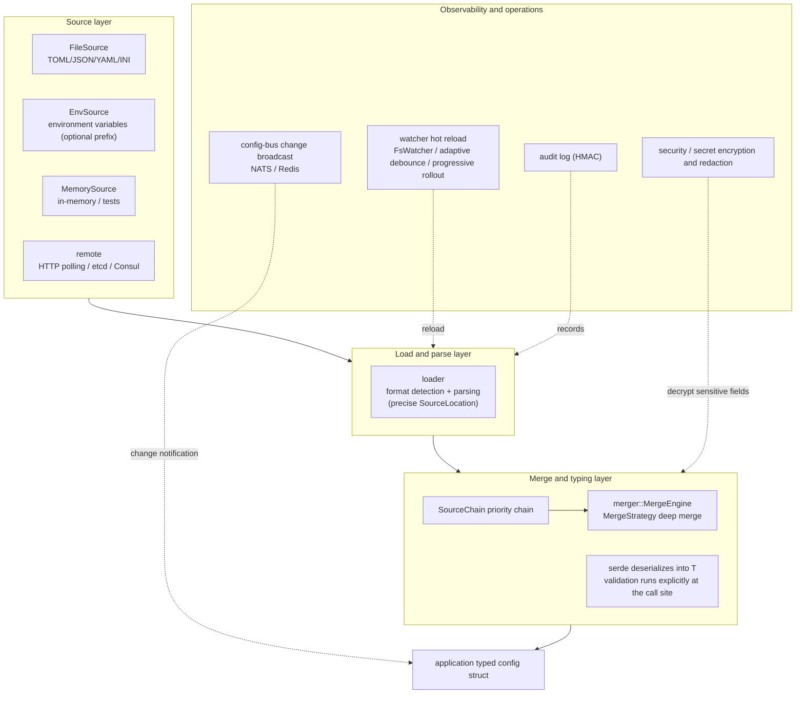
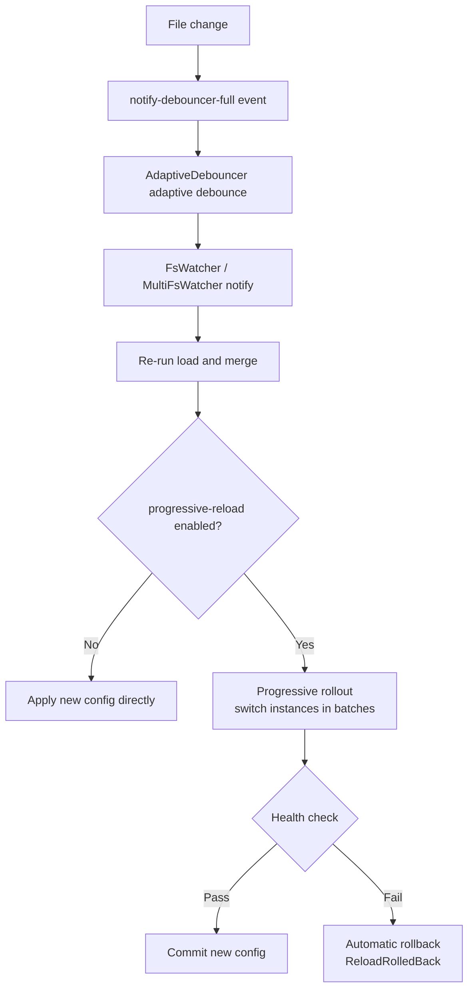

# 🏗️ Confers Architecture

Confers is a production-ready Rust configuration management library built on a "zero boilerplate" design: config loading is driven by a derive macro, multi-source priority is organized as a Source Chain, and configuration-phase errors are separated from runtime errors around the BrickArchitecture. Based on the actual code structure under `src/`, this document covers Confers' design principles, module layout, data flows, and security and performance design.

## 📋 Table of Contents

- [Overview](#-overview)
- [Design Principles](#-design-principles)
- [System Architecture](#️-system-architecture)
- [Module Layout](#-module-layout)
- [Data Flows](#-data-flows)
- [Security Design](#-security-design)
- [Performance Design](#-performance-design)
- [Related Documents](#-related-documents)

---

## 🎯 Overview

The core problem Confers solves: how can Rust applications manage configuration coming from many places in a type-safe, auditable, hot-reloadable way. Its capability boundary is precisely controlled by Cargo features: from the minimal `dotenv` + `json` to the `full` preset covering remote sources, message buses, and encryption, the compiled artifact contains only the features you enable.

Core capabilities at a glance:

- **Derive-macro driven**: `#[derive(Config)]` automatically generates config loading code (provided by the in-workspace `confers-macros` proc-macro crate, implemented in `macros/src/`'s `parse.rs` and the `codegen/` directory).
- **Multi-source priority chain**: files, environment variables, memory, and remote (HTTP/etcd/Consul) merge in declaration order; later additions override earlier ones.
- **Hot reload**: based on file watching (`notify-debouncer-full`) with adaptive debouncing, combined with progressive deployment and health-check rollback.
- **Sensitive field encryption**: XChaCha20-Poly1305 authenticated encryption + HKDF-SHA256 field-level key derivation.
- **Type-safe config keys**: `TypedConfigKey<T>` binds paths and types at compile time.

## 📐 Design Principles

1. **BrickArchitecture error separation**: configuration-phase errors (`ConfigConfigError` — missing fields, parse errors, validation failures at initialization, error codes 2001-2999) and runtime errors (`ConfersError` — timeouts, remote unavailability, decryption failures) are two independent types, letting callers precisely distinguish "should fail at startup" from "needs retry at runtime".
2. **Facade / `impl_` separation**: the public modules under `src/` (`config`, `loader`, `merger`, `format`, `audit`, `dynamic`, `schema`, `lifecycle`, etc.) serve only as forwarding layers (re-exports); the real implementations live in the internal `src/impl_/` modules (e.g. `crate::impl_::config`, `crate::impl_::merger`), keeping implementation details unexposed.
3. **Interface segregation principle (ISP)**: `src/interface.rs` splits capabilities into independent traits: `ConfigReader` / `ConfigWriter` / `ConfigConnector` (feature-gated async/sync reads and writes), `ConfigProvider` (synchronous access), `ConfigProviderExt` (extension trait with convenience methods), `KeyProvider` (encryption key provider), `MetricsBackend` (metrics interface).
4. **Everything is an AnnotatedValue**: every config value carries its source (`SourceId`), exact file location (`SourceLocation`), and priority metadata, supporting auditing, error location, and conflict reports (`ConflictReport`).
5. **Feature gating minimization**: all optional capabilities (`validation`, `watch`, `encryption`, `remote`, `config-bus`, etc.) are independent features; disabled code never compiles, minimizing compile time and binary size.
6. **Unified component lifecycle**: components with background behavior (e.g. ConfigBus) implement the `Lifecycle` trait, providing `health_check()` and graceful shutdown (`shutdown()`).

## 🏛️ System Architecture

Overall four layers: source layer → load/parse layer → merge and typing layer → observability and operations layer, plus the derive macro generating glue code for the application layer at compile time.



The corresponding physical repository layout:

```text
confers/
├── src/            # library body (facade modules + impl_ internals)
│   ├── lib.rs      # module declarations and re-exports (feature-gated)
│   ├── config.rs / loader.rs / types.rs (merger and format are directory modules: merger/, format/)
│   ├── interface.rs / error.rs / lifecycle.rs
│   ├── impl_/      # internal implementations behind the facade above
│   └── <feature>/  # validator, watcher, secret, remote, bus, cli, …
├── macros/         # confers-macros proc-macro crate (parse.rs + codegen/ directory)
├── examples/       # runnable examples
├── fuzz/           # fuzz testing
└── benches/        # Criterion benchmarks
```

## 🧩 Module Layout

### Public core modules (not feature-gated)

| Module | Responsibility | Key Types |
|------|------|----------|
| `config` | public facade for config building and source chains | `ConfigBuilder`, `SourceChain`/`SourceChainBuilder`, `FileSource`, `EnvSource`, `MemorySource`, `Source`, `SourceKind`, `ConfigLimits` |
| `loader` | config file loading and parsing with precise error locations | `Format`, `LoaderConfig`, `load_file`, `parse_content`, `detect_format_from_content/path` |
| `merger` | config merge engine and strategies | `MergeEngine`, `MergeStrategy`, `CustomMergeFn` |
| `format` | forwarding facade for format detection and conversion | per-format converters |
| `types` | config value and metadata types | `ConfigValue`, `AnnotatedValue`, `SourceId`, `SourceLocation`, `ConflictReport`, `ZeroizingBytes`, `KeyCachePolicy` |
| `interface` | core trait definitions (ISP) | `ConfigConnector`, `ConfigReader`, `ConfigWriter`, `ConfigProvider`, `ConfigProviderExt`, `KeyProvider`, `TypedConfigKey` |
| `error` | two-phase error system | `ConfigConfigError` (config phase), `ConfigError`/`ConfersError` (runtime), `ErrorCode`, `SourceWarning`, `ParseLocation` |
| `lifecycle` | component lifecycle management facade | `Lifecycle` |

### Feature-gated modules

| Module | Gating Feature | Responsibility and Key Types |
|------|----------|----------------|
| `validator` | `validation` | garde-based config validation |
| `interpolation` | `interpolation` | `${VAR}` / `${VAR:default}` variable interpolation (depth-aware nesting, self-referencing defaults supported) |
| `watcher` | `watch` | file-watching hot reload: `FsWatcher`, `MultiFsWatcher`, `AdaptiveDebouncer`; the `progressive` submodule implements progressive deployment |
| `secret` | `encryption` | encryption primitives: `XChaCha20Crypto`, `derive_field_key`, `SecretBytes`, `KeyRegistry`, `EnvKeyProvider`/`FileKeyProvider`, etc. |
| `key` | `key-management` | key lifecycle: `KeyManager`, `KeyStorage` (encrypted persistence), `KeyRotationService`/`KeyRotationPolicy`, `KeyVersion`/`KeyInfo` |
| `security` | `security` / `security-rules` | `EnvSecurityValidator` (env injection protection), `ErrorSanitizer` (error redaction), `EncryptionPrefix` (`enc:` prefix recognition), with the `rules` submodule's built-in JWT/CORS/SSRF/TLS validators and `SecurityValidatorRegistry` |
| `audit` | `audit` | audit logging (writer, HMAC integrity, sensitive-field redaction) |
| `dynamic` | `dynamic` | runtime dynamic fields: `DynamicField`/`DynamicFieldBuilder`, `CallbackGuard`, `FieldWatcher`, on `arc-swap` snapshots |
| `snapshot` | `snapshot` | config snapshots and rollback (`SnapshotConfig`) |
| `migration` | `migration` | config version migration (with `#[config(version)]`) |
| `modules` | `modules` | modular config groups: `ModuleConfig`, `ModuleRegistry`, switching per profile |
| `remote` | `remote` / `etcd` / `consul` | HTTP polled sources (`HttpPolledSourceBuilder`, `PollInterval`), etcd/Consul integration, the `circuit_breaker` circuit breaker |
| `bus` | `config-bus` / `nats-bus` / `redis-bus` | multi-instance config-change broadcast: `ConfigBus`, `BusEventLimiter`, on tokio broadcast with NATS / Redis backends |
| `toggle` | `feature-toggle` | runtime feature toggles: `FeatureToggleRegistry` (based on `dashmap`) |
| `context` | `context-aware` | context-aware configuration |
| `schema` | `json-schema` / `typescript-schema` | `TypeScriptGenerator`, generating TS definitions from Rust types |
| `cli` | `cli` | the `confers` command-line tool (clap): inspect, validate, export, diff, snapshot (including list/restore), schema, get, docs, doctor; entry in `src/main.rs` |

### workspace members

| Member | Description |
|------|------|
| `macros/` | `confers-macros`: the `#[derive(Config)]` proc macro; `parse.rs` parses `#[config(...)]` attributes, and the `codegen/` directory (load/schema/clap and other modules) generates loading/validation/CLI helper code |
| `examples/` | 22 runnable examples |
| `fuzz/` | cargo-fuzz fuzzing targets |

## 🌊 Data Flows

### Main config-loading flow

```text
Config declaration             Load                       Merge                      Output
─────────                   ─────────                   ─────────                   ─────────
#[derive(Config)]    →   FileSource / EnvSource  →   SourceChain priority    →   serde deserializes into T
#[config(...)] attribute     Format detect + parse       MergeEngine per-key merge   Caller-side validation
                               ConfigValue + SourceLocation  MergeStrategy (override/   optional sensitive-field
                               (exact row/column)           append/deep/custom)        decryption outputs typed config
```

1. **Source registration**: the application declares sources via `ConfigBuilder` (or `SourceChainBuilder`); order is priority (later additions win).
2. **Parsing**: the `loader` detects each source's format (by content or extension: TOML/JSON/YAML/INI) and parses it into a `ConfigValue` tree; parse errors carry a `SourceLocation` (exact to row and column).
3. **Merging**: `MergeEngine` merges key by key along the source chain, wrapping values as `AnnotatedValue` (source and priority preserved); conflicts can produce a `ConflictReport` / `SourceWarning`; fields may declare a `merge_strategy` (`replace`/`append`/`prepend`/`join`; Maps deep-merge unconditionally).
4. **Typing**: the merge result deserializes into the user struct `T`; with `encryption` enabled, `enc:`-prefixed values are recognized and decrypted. The load/build pipeline never validates automatically — the `validation` feature + `#[config(validate_helper)]` generate `confers_validate()`, invoked explicitly by the caller after `build()` (see [User Guide · Validation and Sanitization](USER_GUIDE.md#-validation-and-sanitization)).
5. **Error exits**: initialization-phase failures at any step return `ConfigConfigError`; runtime failures return `ConfersError`. `build_with_fallback` / `build_resilient` provide degraded builds.

### Hot-reload data flow (`watch` / `progressive-reload`)



Dynamic fields (`dynamic`) provide finer-grained runtime updates: `#[config(dynamic)]` generates a `DynamicField` handle that internally holds a config snapshot in `arc-swap` — readers read lock-free, writers atomically swap in the new snapshot — and can register callbacks (`CallbackGuard`) and field watchers (`FieldWatcher`).

### Multi-instance change broadcast (`config-bus`)

Single-machine hot reload covers only this process. Across instances, `ConfigBus` publishes change events to a message bus (NATS or Redis backend); other instances subscribe and reload individually, with `BusEventLimiter` rate-limiting events to prevent storms.

## 🔒 Security Design

The security design revolves around "whole-lifecycle protection of sensitive data":

1. **Encryption algorithm**: `secret::XChaCha20Crypto` provides XChaCha20-Poly1305 authenticated encryption (AEAD), generating a random nonce per encryption, with ciphertext carrying a Poly1305 authentication tag against tampering.
2. **Field-level key derivation**: `derive_field_key` uses HKDF-SHA256 to derive an independent subkey per field path + key version from the master key, keeping the master key out of direct encryption; key material in `key::KeyStorage` is itself persisted encrypted with XChaCha20.
3. **Memory safety**: `SecretBytes` / `ZeroizingBytes` (zeroize) ensure sensitive bytes are zeroed on drop; `SecretString` (`confers::secret`) implements redacted `Debug`/`Display`, keeping sensitive values out of logs; `ZeroizingBytes` also implements a redacted `Debug` (always `[REDACTED]`), so the master key never reaches logs via `{:?}`; `SourceLocation`'s `Debug` prints no server-side absolute paths (consistent with the privacy contract of its hand-written `Serialize`); `SecureString` forbids `Clone` (since v0.4.0), preventing sensitive material from being copied inadvertently.
4. **Key governance**: `KeyManager` + `KeyRegistry` provide key versions (`KeyVersion`), statuses (Active/Deprecated/Compromised), rotation (`KeyRotationService` rotating on schedule per policy), and entropy validation.
5. **Input protection**: `EnvSecurityValidator` validates environment variable names in allow/block modes against injection; `security::rules` ships four built-in validators — JWT/CORS/SSRF/TLS (SSRF covers 19 blocked CIDR ranges and performs URL boundary matching against bypass) — executable uniformly at startup via `SecurityValidatorRegistry`.
6. **Output redaction**: `ErrorSanitizer` redacts error messages, keeping sensitive config values from leaking through error paths; `#[config(sensitive = true)]` fields are masked automatically in audit logs and debug output.
7. **Audit trail**: the `audit` module records config loads, key access, decryption, and other events; logs are HMAC-signed for integrity and support rotation, archiving, and query.
8. **Remote source protection**: the `remote` module has built-in SSRF validation and a circuit breaker (`circuit_breaker`), guarding against internal-network probing and failure propagation.

## ⚡ Performance Design

Performance design goals: the config read path near zero overhead, and the reload path controllable and observable.

1. **Lock-free dynamic reads**: the `dynamic` module implements snapshot publication on `arc-swap` — lock-free readers, atomic writer swaps, no contention on `DynamicField::get()`.
2. **Concurrency-safe containers**: `feature-toggle` uses `dashmap` sharded locks; the in-memory config cache is an internal implementation of `InMemoryConfig` (relying on `moka` for future/sync dual-mode caching), not exposed via `LoaderConfig`.
3. **Efficient data structures**: the `ConfigValue` tree uses `IndexMap` to keep key order (deterministic merging and output).
4. **Parse performance**: TOML parsing enables `preserve_order`; format detection supports direct content judgment, avoiding repeated disk reads (for large files, read once and hand off to `parse_content`).
5. **Hot-path debouncing**: `watcher::AdaptiveDebouncer` adapts the debounce window, preventing reload storms from editor burst writes.
6. **Compile-time pruning**: all optional capabilities are feature-gated, and with the `minimal`/`recommended`/`dev`/`production`/`full` presets, compile time and binary size are controlled on demand.
7. **Continuous benchmarks**: `benches/` ships 10 Criterion benchmark groups covering the full hot path from cold loading to concurrent reads/writes, reproducible via `cargo bench`; the benchmark suite list and baseline numbers are maintained in [Performance Guide · Benchmark Suite](PERFORMANCE.md#benchmark-suite).

---

## 📚 Related Documents

| Document | Description |
|:-----|:-----|
| [📖 User Guide](USER_GUIDE.md) | user-facing features and best practices |
| [📘 API Reference](API_REFERENCE.md) | complete signatures of each module's public API |
| [⚡ Performance Guide](PERFORMANCE.md) | performance design and benchmark data |
| [🧪 Test Scenario Matrix](TEST_SCENARIOS.md) | acceptance scenarios per feature domain |
