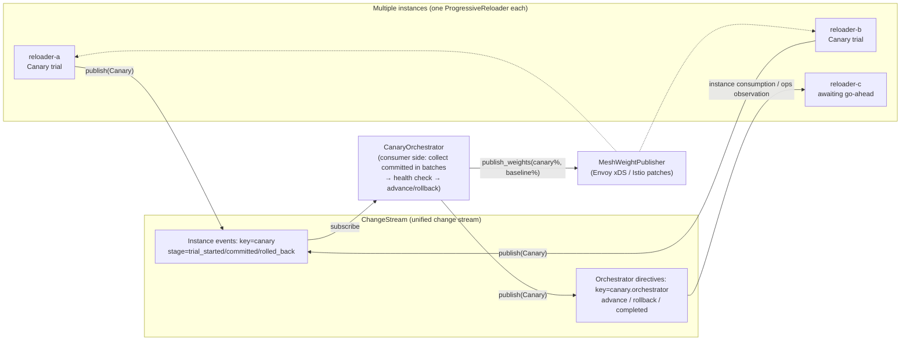

# Canary Rollout Orchestrator

> Feature gating: `canary` (= `change-stream` + `progressive-reload`).
> Components: `confers::CanaryOrchestrator` / `RolloutPlan` / `RolloutHealthCheck` /
> `MeshWeightPublisher` (`src/canary.rs`).

## Architecture and Event Flow



Division of responsibilities (and reuse of single-instance components):

| Component | Responsibility | Semantics Source |
|:-----|:-----|:---------|
| `ProgressiveReloader` (per instance) | in-instance canary trial: health polling, commit/rollback, phase transitions published as `ChangeSource::Canary` events (`with_change_stream`) | `src/watcher/progressive.rs` |
| `CanaryOrchestrator` (consumer side) | cross-instance batched orchestration: collects each batch's `committed` events per the `RolloutPlan`, batch health checks (reusing the `HealthStatus` three-state semantics), publishes advance/rollback instructions | `src/canary.rs` |
| `MeshWeightPublisher` (adaptation layer) | translates rollout progress into baseline↔canary traffic weights (linear growth per batch; rollback snaps fully back to baseline) | the Envoy/Istio samples in this document |

## Phase Strategy (RolloutPlan)

```rust
use confers::canary::RolloutPlan;

let plan = RolloutPlan {
    batch_size: 2,                                  // instances per batch
    batch_interval: std::time::Duration::from_secs(30), // batch observation window (await committed + health polling)
    poll_interval: std::time::Duration::from_secs(5),   // health-check cadence within the window
    failure_threshold: 0.0,                         // Critical ratio cap; exceeding it triggers rollback (0.0 = any Critical rolls back)
};
```

Critical determination is evaluated per round: once the ratio exceeds the threshold, the batch aborts **immediately** (without waiting for the observation window to exhaust); when the window exhausts first, the verdict uses the last observation — worst-case rollback latency is one `batch_interval`, typically one `poll_interval`.

- `Degraded` is recorded but never blocks (consistent with the single-instance `HealthStatus::requires_rollback` semantics; only `Critical` counts toward rollback decisions).
- Within the batch window, collecting `batch_size` `committed` events proceeds to the health check; any instance `rolled_back` event rolls back immediately; a window that exhausts without collecting enough rolls back as a timeout.
- After each batch passes, the `advance` instruction is published and `MeshWeightPublisher::publish_weights(canary_pct, 100 - canary_pct)` is invoked; `canary_pct` grows linearly with batches (1/3 batches ≈ 33%).

## Event Contract

| Event | key | old_value | new_value | Producer |
|:-----|:----|:----------|:----------|:-------|
| Instance phase transition | `canary.<instance_id>` | `trial_started` / `committed` / `rolled_back` / `rejected` | detail | `ProgressiveReloader` (`with_instance_id`) |
| Orchestration instruction | `canary.orchestrator` | `advance` / `rollback` / `completed` | batch number/reason | `CanaryOrchestrator` |

Both are `ChangeSource::Canary`; consumers distinguish them by key prefix. The `canary.orchestrator`
instruction events are advisory signals — instances may consume `rollback` to trigger their local
`ProgressiveReloader` rollback (or an ops platform may execute it).

**Event attribution and batch confirmation**: the orchestrator set-matches the `instance_id` in the
key against the current batch's instance set — duplicate `committed` events fold, unknown-instance
and cross-batch events never count, and a single high-frequency instance cannot fill other
instances' quotas. Reloaders without `with_instance_id` publish as `unknown` and cannot be
attributed (counted toward no batch) — multi-instance deployments must set a unique instance id
for every reloader.

**Failure semantics**: if the mesh weight push or rollback instruction publish fails on the
rollback path, `RolloutOutcome::Aborted.mesh_rolled_back_failed = true` and the reason gains a
failure note (traffic may not have truly switched back — human verification required); on the
advance path a mesh push failure makes `run()` return `Err` (fail-loud after best-effort switch
back to baseline), and the rollout never continues advancing on an ineffective traffic switch.
Failures also count toward `confers_canary_errors_total{reason=...}` and emit a warn under the
`tracing` feature.

### ⚠️ Operational Constraints

- Instances must set a unique `with_instance_id`, never reused within one rollout (attribution dedup relies on its uniqueness).
- Batch confirmation requires instance events to arrive within the batch window; when instances advance autonomously (not waiting for directives), late events count toward their instance's next batch confirmation rather than the current one — instances should start the next batch only after consuming the `advance` directive, or guarantee event arrival within `batch_interval`.
- A `rolled_back` event from an instance in the current batch **or any advanced batch** aborts the entire rollout immediately — a rollback on an advanced instance means the candidate version regressed on promoted config, and later batches must not continue; never share one stream across unrelated rollouts.
- Health-check implementations must honor the `poll_interval` upper bound (a single check exceeding the window remainder is recorded as Degraded), avoiding stalling the whole window.

## Local Multi-Instance Simulation (in-process reloaders)

Equivalent verification when sandboxes/CI lack a real cluster: N `ProgressiveReloader`s attach to the
same `InMemoryChangeStream`, each running a real canary trial via `begin_reload`; the orchestrator
consumes their events to drive batching. The complete runnable test is `src/canary.rs`
`orchestrates_in_process_reloaders_end_to_end` (two instances, one batch, asserting the
advance→completed instruction sequence).

## Service Mesh Integration Adaptation Layer

`MeshWeightPublisher` abstracts "batch passed" into two traffic-weight sets; the mesh-side
implementation only needs to push weights once. The equivalent Envoy and Istio configs follow
(using a 25% traffic switch as the example).

### Envoy (weighted clusters, dynamic xDS delivery)

The adaptation layer calls Envoy Admin/EDS to update cluster weights; the static reference config:

```yaml
# envoy.yaml (excerpt): baseline and canary upstream clusters split traffic by weight
static_resources:
  listeners:
    - name: app_listener
      address: { socket_address: { address: 0.0.0.0, port_value: 8080 } }
      filter_chains:
        - filters:
            - name: envoy.filters.network.http_connection_manager
              typed_config:
                "@type": type.googleapis.com/envoy.extensions.filters.network.http_connection_manager.v3.HttpConnectionManager
                stat_prefix: app
                route_config:
                  name: canary_routes
                  virtual_hosts:
                    - name: app
                      domains: ["*"]
                      routes:
                        - match: { prefix: "/" }
                          route:
                            weighted_clusters:
                              clusters:
                                - name: baseline_cluster
                                  weight: 75      # ← baseline side of publish_weights(25, 75)
                                - name: canary_cluster
                                  weight: 25      # ← canary side (grows linearly with batches)
  clusters:
    - name: baseline_cluster
      connect_timeout: 1s
      type: STATIC
      load_assignment:
        cluster_name: baseline_cluster
        endpoints: [{ lb_endpoints: [{ endpoint: { address: { socket_address: { address: 10.0.0.10, port_value: 9000 } } } }] }]
    - name: canary_cluster
      connect_timeout: 1s
      type: STATIC
      load_assignment:
        cluster_name: canary_cluster
        endpoints: [{ lb_endpoints: [{ endpoint: { address: { socket_address: { address: 10.0.0.20, port_value: 9000 } } } }] }]
```

Rust adaptation-layer skeleton (a production implementation replaces the internals of `publish_weights` with an xDS RDS/CDS patch or Admin `POST /clusters` adjustments):

```rust
use async_trait::async_trait;
use confers::canary::MeshWeightPublisher;
use confers::error::ConfigResult;

struct EnvoyWeightPublisher {
    /// xDS control plane / Admin endpoint, e.g. http://envoy-admin:9901
    admin_endpoint: String,
    http: reqwest::Client,
}

#[async_trait]
impl MeshWeightPublisher for EnvoyWeightPublisher {
    async fn publish_weights(&self, canary_pct: u8, baseline_pct: u8) -> ConfigResult<()> {
        // Production implementation: update the weighted_clusters weights via xDS
        // (or the Admin API) to (canary_pct, baseline_pct). Admin path shown here for illustration.
        let url = format!("{}/clusters", self.admin_endpoint);
        self.http.post(url)
            .body(format!(
                "canary_cluster::weight={canary_pct}\nbaseline_cluster::weight={baseline_pct}\n"
            ))
            .send()
            .await
            .map_err(|e| confers::error::ConfigError::InvalidValue {
                key: "envoy".into(),
                expected_type: "weight update".into(),
                message: e.to_string(),
            })?;
        Ok(())
    }
}
```

### Istio (VirtualService weighted routing)

The adaptation layer calls the Istio CRD Patch (`k8s-openapi`/`kube` or `istioctl`);
the target VirtualService:

```yaml
apiVersion: networking.istio.io/v1beta1
kind: VirtualService
metadata:
  name: app-canary
spec:
  hosts: ["app.example.com"]
  http:
    - route:
        - destination: { host: app, subset: baseline }
          weight: 75            # ← baseline side of publish_weights(25, 75)
        - destination: { host: app, subset: canary }
          weight: 25            # ← canary side (grows linearly with batches)
---
apiVersion: networking.istio.io/v1beta1
kind: DestinationRule
metadata:
  name: app-canary
spec:
  host: app
  subsets:
    - name: baseline
      labels: { version: stable }
    - name: canary
      labels: { version: canary }
```

Rust adaptation-layer skeleton (the production implementation is `PATCH /apis/networking.istio.io/v1beta1/
namespaces/<ns>/virtualservices/app-canary`, replacing the two routes' `weight`):

```rust
struct IstioWeightPublisher {
    /// k8s API endpoint and namespace
    api: String,
    namespace: String,
    http: reqwest::Client,
}

#[async_trait]
impl MeshWeightPublisher for IstioWeightPublisher {
    async fn publish_weights(&self, canary_pct: u8, baseline_pct: u8) -> ConfigResult<()> {
        let url = format!(
            "{}/apis/networking.istio.io/v1beta1/namespaces/{}/virtualservices/app-canary",
            self.api, self.namespace
        );
        let patch = format!(
            r#"{{"spec":{{"http":[{{"route":[
                {{"destination":{{"host":"app","subset":"baseline"}},"weight":{baseline_pct}}},
                {{"destination":{{"host":"app","subset":"canary"}},"weight":{canary_pct}}}
            ]}}]}}}}"#
        );
        self.http.patch(url)
            .header("Content-Type", "application/merge-patch+json")
            .body(patch)
            .send()
            .await
            .map_err(|e| confers::error::ConfigError::InvalidValue {
                key: "istio".into(),
                expected_type: "virtualservice patch".into(),
                message: e.to_string(),
            })?;
        Ok(())
    }
}
```

Assembly (orchestrator + mesh):

```rust
use confers::canary::{CanaryOrchestrator, MeshWeightPublisher, RolloutPlan, RolloutHealthCheck};
use std::sync::Arc;

async fn rollout(
    stream: Arc<dyn confers::ChangeStream>,
    instances: Vec<String>,
    health: Arc<dyn RolloutHealthCheck>,
    mesh: Arc<dyn MeshWeightPublisher>,
) -> confers::error::ConfigResult<()> {
    let orchestrator = CanaryOrchestrator::new(
        stream,
        instances,
        RolloutPlan {
            batch_size: 2,
            ..Default::default()
        },
        health,
    )
    .with_mesh(mesh);
    orchestrator.run().await.map(|_| ())
}
```

## Test Matrix

| Scenario | Test | Assertion |
|:-----|:-----|:-----|
| Batched advance + completion | `advances_in_batches_and_completes` | `Completed{batches:2}` + the advance/advance/completed instruction sequence |
| Batch health Critical → rollback | `rolls_back_when_batch_health_is_critical` | `Aborted` + rollback instruction |
| committed timeout → rollback | `aborts_when_committed_events_time_out` | `Aborted` + rollback |
| Degraded does not block | `degraded_health_does_not_block` | `Completed` |
| Instance rolled_back → abort | `instance_rollback_aborts_the_rollout` | `Aborted` |
| Mesh weights linear + snap back to zero | `mesh_weights_track_progress_and_snap_back` | `[(50,50),(0,100)]` |
| In-process dual-reloader end-to-end | `orchestrates_in_process_reloaders_end_to_end` | real reloader events → `Completed` |
