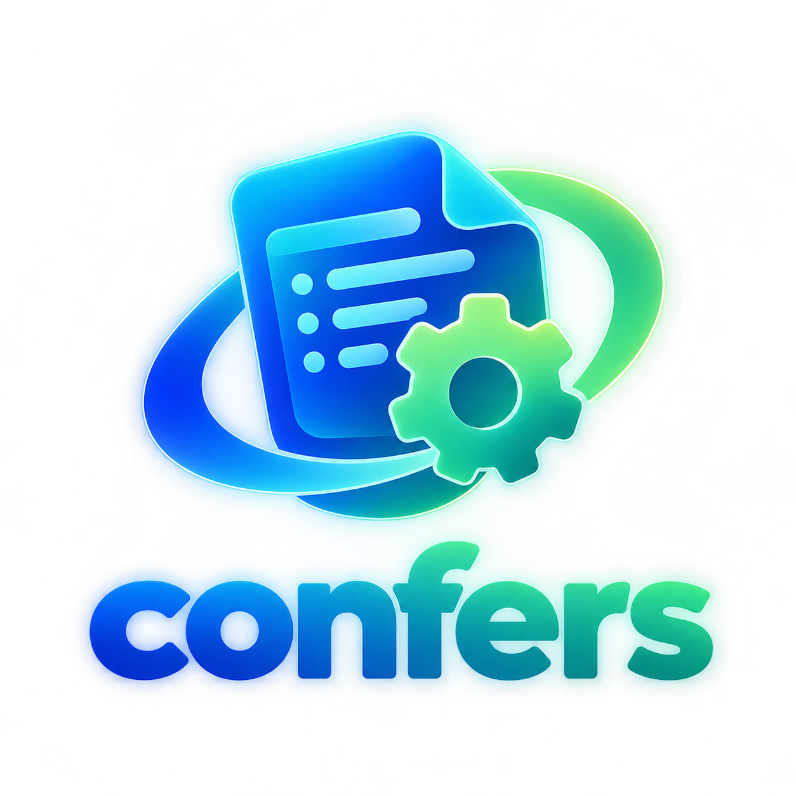
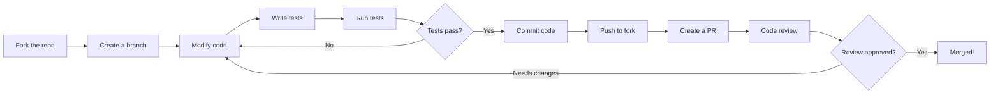
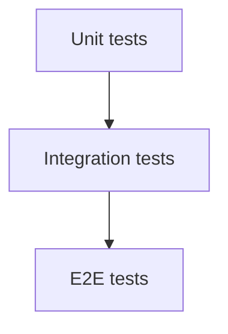

# 🤝 Contributing to Confers



Thank you for your interest in **confers**! Whether you are fixing bugs, adding features, improving documentation, or helping others, your contribution is invaluable.

## 📋 Table of Contents

- [Welcome](#-welcome)
- [Environment Setup](#-environment-setup)
- [Development Workflow (TDD)](#-development-workflow-tdd)
- [Code Standards](#-code-standards)
- [Commit and PR Process](#-commit-and-pr-process)
- [Code of Conduct](#-code-of-conduct)

---

## 👋 Welcome

Welcome to building **confers**!

**Ways to contribute:**

| Code | Docs | Testing | Community |
|:-----|:-----|:-----|:-----|
| fix bugs, add features | improve documents and guides | write tests, find issues | help and support others |

---

## 🧰 Environment Setup

### Prerequisites

Before starting, confirm the following are installed:

- **Git** - version control
- **Rust 1.97.1+** - the programming language
- **Cargo** - the Rust package manager
- **IDE** - VS Code (rust-analyzer extension recommended), IntelliJ IDEA, or similar

<details>
<summary>🔧 Environment Installation Steps</summary>

**1. Install Rust:**

```bash
curl --proto '=https' --tlsv1.2 -sSf https://sh.rustup.rs | sh
```

**2. Install helper tools:**

```bash
# Code formatter
rustup component add rustfmt

# Static analysis tool
rustup component add clippy

# Code coverage tool (optional)
cargo install cargo-llvm-cov
```

**3. Verify the installation:**

```bash
rustc --version
cargo --version
```

</details>

### Fork and Clone

| Step | Action |
|:----:|:-----|
| **1. Fork the repository** | click the "Fork" button on GitHub |
| **2. Clone** | `git clone https://github.com/YOUR_USERNAME/confers` |
| **3. Add upstream** | `git remote add upstream https://github.com/Kirky-X/confers` |
| **4. Verify** | `git remote -v` |

### Finishing Environment Setup

Before developing, confirm the dev environment is ready:

```bash
# Install the Rust toolchain
curl --proto '=https' --tlsv1.2 -sSf https://sh.rustup.rs | sh

# Install required components
rustup component add rustfmt clippy

# Install project dependencies
cargo build
```

### Feature Flags

This project uses feature flags to enable different capabilities. During development, note:

**Default features:** `toml`, `json`, `dotenv`

The complete list of all single features and feature presets (mapping item by item to the `[features]` definition in `Cargo.toml`) is maintained in [README · Feature Matrix](../../README.md#-feature-matrix).

Tests can run under different feature combinations:

```bash
cargo test --all-features  # run tests with all features
cargo test --features cli  # run only CLI-related tests
cargo test --features remote  # run only remote-config-related tests
```

### Git Hooks (lefthook)

The repository uses [lefthook](https://github.com/evilmartians/lefthook) for local quality gates (enable with `lefthook install`):

| Hook | Checks |
|:-----|:-----|
| pre-commit | `cargo fmt --all -- --check`, `cargo clippy --all-targets --all-features -- -D warnings`, `cargo deny check`, private-key scan (`no-private-key`) |
| commit-msg | Conventional Commits format validation (`feat`, `fix`, `docs`, etc.) |
| pre-push | `cargo audit`, the coverage gate (`cargo llvm-cov --fail-under-lines 90`) |

### Build and Test

```bash
# Build the project
cargo build

# Run all tests
cargo test --all-features

# Run an example (the examples crate pins the full feature set for its confers dependency)
cargo run -p confers-examples --bin basic_usage
```

---

## 🔄 Development Workflow (TDD)

This project follows test-driven development (TDD): write the test first, then the implementation, letting tests drive code evolution.



### Detailed Steps

#### 1️⃣ Create a Branch

Branches should be created off `main`.

```bash
# Sync the main branch from upstream
git fetch upstream
git checkout main
git merge upstream/main

# Create a feature branch
git checkout -b feature/TICKET-ID-description

# Or create a bugfix branch
git checkout -b bugfix/TICKET-ID-description
```

**Branch naming conventions:**

| Type | Prefix | Example |
|:-----|:-----|:-----|
| New feature | `feature/*` | `feature/add-encryption` |
| Bug fix | `bugfix/*` | `bugfix/fix-memory-leak` |
| Urgent fix | `hotfix/*` | `hotfix/critical-security` |
| Release | `release/*` | `release/v1.0.0` |
| Refactor | `refactor/*` | `refactor/improve-perf` |
| Docs | `docs/*` | `docs/update-readme` |

#### 2️⃣ Write Tests and Run Static Checks

Before committing, make sure the code passes all local checks.

```bash
# Format the code
cargo fmt

# Run Clippy static analysis (zero warnings required)
cargo clippy -- -D warnings

# Run all tests
cargo test --all-features
```

#### 3️⃣ Commit Code

We follow the [Conventional Commits](https://www.conventionalcommits.org/) convention.

**Commit format:**
`<type>(<scope>): <subject>`

**Common types:**

| Type | Description | Example |
|:-----|:-----|:-----|
| `feat` | new feature | `feat(auth): add JWT token refresh` |
| `fix` | bug fix | `fix(loader): resolve memory leak` |
| `docs` | documentation | `docs: update README` |
| `style` | code format | `style: format code` |
| `refactor` | refactoring | `refactor: improve performance` |
| `perf` | performance | `perf: optimize hot path` |
| `test` | testing | `test: add unit tests` |
| `chore` | build tooling | `chore: update dependencies` |

**Example:**

```bash
git commit -m "feat(auth): add JWT token refresh mechanism"
```

#### 4️⃣ Merge and Clean Up (Mandatory)

After finishing development or a bug fix, you **must** merge back to the main branch and clean up following this mandatory process:

**Step 1: quality checks before merging**

Make sure all quality checks pass before merging:

```bash
# Make sure the code is formatted
cargo fmt

# Run Clippy static analysis (zero warnings required)
cargo clippy -- -D warnings

# Run all tests with all features enabled
cargo test --all-features
```

**Merging is only allowed after all checks pass.**

**Step 2: merge into main**

```bash
# Switch to the main branch
git checkout main

# Sync with upstream
git fetch upstream
git merge upstream/main

# Merge your feature/bugfix branch
git merge --no-ff feature/TICKET-ID-description

# Resolve conflicts if any
# Re-run the quality checks after resolving conflicts
cargo fmt && cargo clippy -- -D warnings && cargo test --all-features

# Push the merge result
git push origin main
```

**Step 3: clean up completed branches**

After a successful merge, **cleanup is mandatory**:

```bash
# Delete the local branch
git branch -d feature/TICKET-ID-description

# Delete the remote branch (if pushed)
git push origin --delete feature/TICKET-ID-description

# Remove it if you used a git worktree
git worktree remove /path/to/worktree
```

**Important:**
- ✅ delete the branch after a successful merge to keep the repository tidy
- ✅ do not let completed branches linger in the repository
- ✅ if the merge fails, fix the problem, re-run the quality checks, and retry
- ✅ for worktree-based development, remove the worktree after merging
- ❌ never skip cleanup — accumulated branches make the repository messy

### Testing Requirements

#### Test Pyramid



| Test Type | Description | Requirement |
|:---------|:-----|:-----|
| **Unit tests** | fast, independent, verifying core logic | coverage ≥ 90% |
| **Integration tests** | verifying interactions between modules | all passing |
| **E2E tests** | verifying critical business flows | core paths 100% |

#### Coverage Requirements

The following coverage requirements are in effect (overall line coverage ≥ 90% is the active gate, enforced doubly by CI and the pre-push hook — see `.github/workflows/ci.yml` and `lefthook.yml`):

| Module | Target | Key Requirement |
|:-----|:----:|:---------|
| Core (loader, merger, value) | >= 90% | including edge conditions |
| Encryption | >= 90% | every attack path must be covered |
| Validation | >= 85% | all rule types covered |
| Migration | >= 85% | upgrade and downgrade paths covered |
| Snapshot | >= 85% | consistency guarantees |
| Other modules | >= 80% | overall average |
| **Overall target** | **>= 90%** | average across all code |

**Coverage verification commands:**

```bash
# Generate a coverage report (HTML)
cargo llvm-cov --all-features --open

# Generate LCOV format for CI integration
cargo llvm-cov --all-features --lcov --output-path lcov.info

# Run all tests
cargo test --all-features

# Quick coverage check
cargo llvm-cov --all-features --summary-only
```

**CI enforcement:**
- Codecov integrated via GitHub Actions
- PRs below the 90% coverage threshold are blocked
- Every PR generates a coverage report

---

## 📐 Code Standards

### Rust Best Practices

| Category | Requirement |
|:-----|:-----|
| **Ownership and borrowing** | prefer borrowing over moving ownership; use `&` for immutable borrows |
| **Type system** | use `Option<T>` instead of nulls and `Result<T, E>` for errors |
| **Concurrency and async** | use `Arc<RwLock<T>>` for shared mutable data; prefer channels for cross-thread communication |
| **Performance** | preallocate with `Vec::with_capacity()`; prefer iterator chains |

### Naming Conventions

| Type | Convention | Example |
|:-----|:-----|:-----|
| Modules, functions, variables | `snake_case` | `load_config()` |
| Types, traits | `PascalCase` | `ConfigLoader` |
| Constants, statics | `SCREAMING_SNAKE_CASE` | `MAX_CACHE_SIZE` |

### Code Quality Requirements

| Requirement | Description |
|:-----|:-----|
| **Zero-warning state** | never ignore compiler warnings |
| **Clippy** | must pass `cargo clippy -- -D warnings` |
| **Code format** | use `cargo fmt` for consistent formatting |
| **Doc comments** | all public APIs (`pub`) must carry `///` docs |

### Documentation Standards

| Requirement | Description |
|:-----|:-----|
| **Public APIs** | every `pub` item must have a `///` doc comment |
| **Example code** | doc comments should include runnable examples |
| **Sync updates** | code changes must update the README and API docs in sync |

---

## 📤 Commit and PR Process

### PR Submission Standards

- **Atomicity**: each commit/PR contains exactly one logical change
- **Size limit**: keep PR changes within about 400 lines
- **Link issues**: the PR description must reference the related issue

### PR Template

```markdown
## Change Description

<!-- Briefly describe what this PR does and why -->

## Change Type

- [ ] feat: new feature
- [ ] fix: bug fix
- [ ] refactor: refactoring
- [ ] perf: performance improvement
- [ ] docs: documentation
- [ ] test: tests
- [ ] chore: miscellaneous
- [ ] ci: CI/CD
- [ ] breaking: breaking change

## Checklist

- [ ] Code passes `cargo fmt --all -- --check`
- [ ] Code passes `cargo clippy --all-targets -- <feature set> -- -D warnings`
- [ ] Tests pass `cargo test --workspace <feature set>`
- [ ] New features have corresponding test coverage
- [ ] New features have a corresponding example
- [ ] Documentation updated (if needed)
- [ ] docs/CHANGELOG.md updated (for user-visible changes)

## Related Issue

<!-- Related issue number, e.g. Closes #123 -->
```

### Review Criteria

| Dimension | Description |
|:-----|:-----|
| **Functionality** | meets requirements, logic correct |
| **Code quality** | follows SOLID principles, readable, no duplicated code |
| **Security** | no hard-coded sensitive information, input validated |
| **Performance** | no obvious performance problems |

---

## 🤗 Code of Conduct

We are committed to providing a welcoming and inclusive environment. Participating in this project means you agree to:

**✅ Expected behavior**

- Mutual respect and consideration
- Welcoming newcomers
- Accepting constructive criticism
- Putting community interests first
- Empathizing with others

**❌ Unacceptable behavior**

- Offensive language
- Harassment or insults
- Publishing others' private information
- Personal attacks
- Disrupting discussions

---

### 💝 Thank you for contributing to Confers!

**[📖 User Guide](USER_GUIDE.md)** • **[🏗️ Architecture](ARCHITECTURE.md)** • **[🧪 Test Scenario Matrix](TEST_SCENARIOS.md)** • **[❓ FAQ](FAQ.md)** • **[🐛 Report an issue](https://github.com/Kirky-X/confers/issues)**
