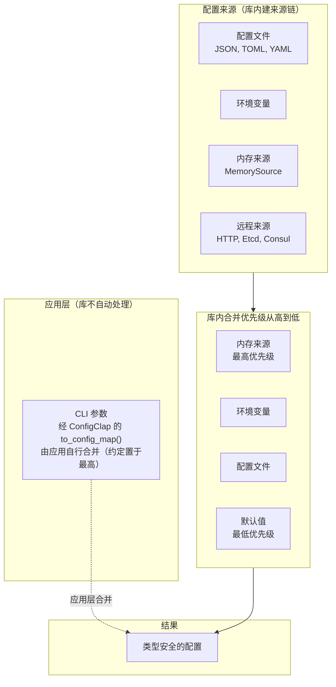

# 📖 Confers User Guide

**confers** is a powerful Rust configuration management library designed to simplify config loading, validation, and management for applications. It supports loading configuration from files (JSON, TOML, YAML, INI), environment variables, command-line arguments, and remote sources (HTTP, Etcd, Consul). This guide takes you from installation to advanced usage and best practices.

## 📋 Table of Contents

- [Introduction](#-introduction)
- [Quick Start](#-quick-start)
  - [Prerequisites](#-prerequisites)
  - [Installation](#-installation)
  - [First Steps](#-first-steps)
- [Core Concepts](#-core-concepts)
  - [The Config Derive Macro](#the-config-derive-macro)
  - [The Config Derive Macro](#the-config-derive-macro)
  - [Layered Loading](#layered-loading)
  - [Layered Loading](#layered-loading)
  - [Flexible Data Sources](#flexible-data-sources)
  - [Flexible Data Sources](#flexible-data-sources)
  - [Config File Loading](#config-file-loading)
  - [Config File Loading](#config-file-loading)
- [Configuration](#️-configuration)
  - [Defining Config Structs](#-defining-config-structs)
  - [Loading Config](#-loading-config)
  - [Defaults and Environment Variables](#-defaults-and-environment-variables)
  - [Command Line Tool](#-command-line-tool)
- [Advanced Usage](#-advanced-usage)
  - [Validation and Sanitization](#-validation-and-sanitization)
  - [Remote Config (Etcd/Consul/HTTP)](#️-remote-config-etcdconsulhttp)
  - [Audit Logging and Security](#-audit-logging-and-security)
  - [File Watching and Hot Reload](#-file-watching-and-hot-reload)
  - [Sensitive Data Encryption](#-sensitive-data-encryption)
  - [Distributed Tracing (tracing)](#-distributed-tracing-tracing)
- [Best Practices](#-best-practices)
  - [Recommended Design Patterns](#-recommended-design-patterns)
  - [Security Configuration Practices](#-security-configuration-practices)
- [Troubleshooting](#-troubleshooting)
- [Further Reading](#-further-reading)

---

## 🎯 Introduction

This guide helps you master:

| Content | Description |
|:-----|:-----|
| **Quick Start** | environment set up in 5 minutes |
| **Flexible Configuration** | multiple sources and formats supported |
| **Best Practices** | learn disciplined configuration management |
| **Advanced Features** | master hot reload and remote config |

> 💡 **Tip**: this guide assumes basic Rust knowledge. If you are new to Rust, read the [official Rust tutorial](https://doc.rust-lang.org/book/) first.

---

## 🚀 Quick Start

### 📌 Prerequisites

Before starting, confirm the following tools are installed:

**Required**

- ✅ Rust 1.97.1+ (stable)
- ✅ Cargo (installed with Rust)
- ✅ Git

**Optional**

- 🔧 A Rust-capable IDE (e.g. VS Code + rust-analyzer)
- 🔧 Docker (for containerized deployment)
- 🔧 Etcd (for remote config testing)

<details>
<summary>🔍 Verify the Installation</summary>

```bash
# 检查 Rust 版本
rustc --version
# 期望输出：rustc 1.97.1（或更高）

# 检查 Cargo 版本
cargo --version
# 期望输出：cargo 1.97.1（或更高）
```

</details>

### 📦 Installation

Add `confers` to your `Cargo.toml`:

| Installation Mode | Configuration | Use Case |
|----------|------|----------|
| **Default** | `confers = "0.6.0"` | includes toml, json, dotenv |
| **Minimal** | `confers = { version = "0.6.0", default-features = false, features = ["minimal"] }` | dotenv + JSON (matching Cargo.toml's `minimal = ["dotenv", "json"]`) |
| **Recommended** | `confers = { version = "0.6.0", default-features = false, features = ["recommended"] }` | TOML + JSON + Dotenv + validation + security rules |
| **Full** | `confers = { version = "0.6.0", features = ["full"] }` | all features |

**Available feature presets:**

The per-preset feature lists and use cases of the six presets `minimal` / `recommended` / `dev` / `production` / `distributed` / `full` are maintained in [README · Feature Presets](../../README.md#-feature-flags).

**Single features:**

Every optional capability is an independent feature flag; the complete single-feature matrix (with default-enabled state and descriptions, mapping item by item to the `[features]` definition in `Cargo.toml`) is in [README · Feature Matrix](../../README.md#-feature-matrix).

For async/remote support, add tokio:

```toml
[dependencies]
tokio = { version = "1.0", features = ["full"] }
```

### 💡 First Steps

Verify the installation with a simple example. Define a config struct with defaults and environment variable mapping:

```rust
use confers::{Config, ConfigBuilder};
use serde::{Deserialize, Serialize};

#[derive(Debug, Serialize, Deserialize, Config)]
#[config(env_prefix = "APP_")]
struct ConfersConfig {
    #[config(default = 8080)]
    port: u16,

    #[config(default = "\"localhost\".to_string()")]
    host: String,
}

fn main() -> Result<(), Box<dyn std::error::Error>> {
    // 使用 ConfigBuilder 加载配置
    let config = ConfigBuilder::<ConfersConfig>::new()
        .file("config.toml")
        .env_prefix("APP_")
        .build()?;

    println!("🚀 Server running at: {}:{}", config.host, config.port);
    Ok(())
}
```

For hot-reload capability, use `FsWatcher` to watch file changes and rebuild the config (recommended); see [👀 File Watching and Hot Reload](#-file-watching-and-hot-reload) for full usage.

**Notes**: the `Config` derive macro provides type-safe configuration. Load with `ConfigBuilder`:
- `ConfigBuilder::<T>::new().build()`: synchronous loading
- `ConfigBuilder::<T>::new().build_with_fallback(fallback)`: with a fallback config
- `ConfigBuilder::<T>::new().build_with_watcher().await`: **⚠️ deprecated since 0.3.0** (no longer reloads on file changes; for hot reload use `FsWatcher`/`MultiFsWatcher` directly)

---

## 🔑 Core Concepts

Understanding the following core concepts helps you use `confers` more effectively.



### The Config Derive Macro

At the heart of `confers` is the `Config` derive macro. It automatically implements config-loading logic for your structs, including defaults, environment variable prefixes, and validation rules.

### Layered Loading

`confers` follows the "last definition wins" principle; the library's built-in source chain merges configuration in the following priority order:

1. **Memory source** (`MemorySource`, highest priority)
2. **Environment variables**
3. **Config files** (e.g. `config.toml`)
4. **Defaults** (lowest priority)

Command-line arguments are not part of the library's built-in source chain: the `ConfigClap` derive provides `to_config_map()`, letting the application layer decide when and in what order to merge (by convention at the highest priority).

### Flexible Data Sources

You can easily combine configuration from different sources:

- **Files**: JSON, TOML, YAML, and INI formats auto-detected.
- **Environment variables**: auto-mapped via `env_prefix`.
- **Remote**: HTTP polling, Etcd, and Consul supported.

### Config File Loading

`confers` **never searches for config file paths automatically**. The derived macro's `Config::load_sync()` reads only field defaults and declared environment variables; config files must be loaded with an explicit path.

#### `load_sync()` Reads Only Environment Variables and Defaults

The `load()` / `load_sync()` generated by `#[derive(Config)]` reads no config files (not even a `config.toml` in the current directory). It assembles fields purely by the "defaults lowest, environment variables highest" priority:

```rust
#[derive(Debug, Serialize, Deserialize, Config)]
#[config(env_prefix = "APP_")]
pub struct ConfersConfig {
    #[config(default = "\"127.0.0.1\".to_string()")]
    pub host: String,
    #[config(default = "8080")]
    pub port: u16,
}

// 只消费 APP_HOST / APP_PORT 等环境变量与字段默认值，
// 当前目录即使存在 config.toml 也不会被读取。
let config = ConfersConfig::load_sync()?;
```

#### Explicitly Specifying Config File Paths

When you need a config file, give the exact path via `ConfigBuilder::file()` or `Config::load_file()`:

```rust
use confers::ConfigBuilder;

let config = ConfigBuilder::<ConfersConfig>::new()
    .file("/etc/myapp/production.toml")
    .env()                      // 可选：叠加环境变量
    .build()?;
```

> ⚠️ **Note**: when a file given to `file()` does not exist, a `ConfigFileNotFound` error is returned — no silent fallback to defaults. Paths must be exact; `confers` does not search multiple directories.

#### Environment-Specific Overlay Files (profile overlay)

With `#[config(profile)]` enabled, when `RUN_ENV` (or the variable named by `profile_env`) is set to a non-empty value, `confers` looks for an overlay file named `<stem>.<env>.<extension>` in the **same directory as the base file** and merges it in declaration order; a missing overlay file is silently skipped:

```rust
#[derive(Debug, Serialize, Deserialize, Config)]
#[config(profile)]  // profile_env 默认为 RUN_ENV
pub struct AppConfig {
    pub log_level: String,
}

// RUN_ENV=production 时，file("config.toml") 会在同目录追加加载
// config.production.toml（后者覆盖前者的同名键）。
```

#### What `app_name` Actually Does

`app_name` is an optional application identifier; the macro only validates its length and non-emptiness, and in the generated CLI helper code it is used as the application's display name. It does **not** participate in any config-file directory search or path derivation:

```rust
#[derive(Debug, Serialize, Deserialize, Config)]
#[config(app_name = "myapp")]  // 仅作校验与 CLI 显示名
pub struct ConfersConfig {
    pub host: String,
    pub port: u16,
}
```

#### Best-Practice Recommendations

1. **Applications**: use `ConfigBuilder::file()` to give the exact config file path (you can assemble system-standard directories yourself with `std::env::var("HOME")` etc.)

2. **Libraries/tools**: prefer environment variables and field defaults (`load_sync()`), keeping zero file dependencies

3. **Tests/special needs**: use `load_file()` with an exact path

4. **Multi-environment deployment**: enable `#[config(profile)]` and switch `<stem>.<env>.<ext>` overlay files with `RUN_ENV`

> 💡 **Tip**: `load_sync()` falls back to field defaults when environment variables are absent; a file specified by `file()`/`load_file()` that is missing errors out directly. For multi-file overlays, chain multiple `file()` calls on `ConfigBuilder` in declaration order (later declarations override earlier ones).

---

## ⚙️ Configuration

This section covers defining config structs, loading configuration, and using the companion command-line tool.

### 🧱 Defining Config Structs

Use `#[derive(Config)]` with `#[config(...)]` attributes to configure your structs. Nested structs are also supported:

```rust
use serde::Deserialize;
use confers::Config;

#[derive(Config, Deserialize)]
struct DatabaseConfig {
    #[config(default = "\"localhost\".to_string()")]
    host: String,
    #[config(default = "5432")]
    port: u16,
}

#[derive(Config, Deserialize)]
#[config(env_prefix = "MYAPP_")]
struct MyConfig {
    #[config(default = "100")]
    timeout_ms: u64,

    // 嵌套结构体
    db: DatabaseConfig,

    // 敏感字段必须使用 SecretString / SecretBytes 类型（需 encryption 特性），
    // 审计日志与 debug 输出中自动脱敏
    #[config(sensitive = true)]
    api_key: SecretString,
}
```

### 📥 Loading Config

`confers` provides `ConfigBuilder` for flexible config loading:

```rust
use confers::ConfigBuilder;

// 基础同步加载
let config = ConfigBuilder::<MyConfig>::new()
    .file("config.toml")
    .build()?;

// 带环境变量与前缀
let config = ConfigBuilder::<MyConfig>::new()
    .file("config.toml")
    .env_prefix("MYAPP_")
    .build()?;

// 设置资源上限（文件大小、嵌套深度、键数量等）
use confers::ConfigLimits;
let config = ConfigBuilder::<MyConfig>::new()
    .file("config.toml")
    .limits(ConfigLimits::default())
    .build()?;
```

> 💡 **Tip**: declare validation rules with `garde`; the `validation` feature + the `#[config(validate_helper)]` attribute generate a `confers_validate()` helper that the caller must invoke explicitly after `build()` — the build/load pipeline does not validate automatically (`#[config(validate)]` is a compatibility no-op, see the [Validation and Sanitization](#-validation-and-sanitization) section). Hot reload (async, requires the `watch` feature) is implemented via `FsWatcher`; see the [File Watching and Hot Reload](#-file-watching-and-hot-reload) section.

### 🔢 Defaults and Environment Variables

- **Defaults**: use the `#[config(default = ...)]` attribute. Numeric types take literal numbers; strings use expression syntax.
- **Environment variables**: the default mapping rule is `PREFIX_FIELD_NAME`. For example, `MYAPP_TIMEOUT_MS` maps to `timeout_ms`.

### 💻 Command Line Tool

confers ships a diagnostics CLI with code generated from the config type (`cli` feature), supporting config inspection, export, diffing, snapshot management, and health diagnostics.

#### Installing the CLI

```bash
# 从源码安装（启用 cli 特性）
cargo install confers --features cli

# 查看帮助与版本
confers --help
confers --version
```

#### Command Reference

```text
Configuration diagnostics tool for confers

Usage: confers [OPTIONS] <COMMAND>

Commands:
  inspect   Inspect configuration - list all keys with their sources
  validate  Validate configuration against schema
  export    Export merged configuration (sanitized)
  diff      Diff two configurations
  snapshot  Manage configuration snapshots
  schema    Output JSON Schema for the configuration type
  get       Get a specific configuration value by key path (dot-separated)
  docs      Documentation output. `--agent` emits the machine-readable knowledge pack (subcommands, arguments, exit-code contract, task recipes)
  doctor    Diagnose configuration health (schema, source chain, encryption, env overrides) and print a single-line JSON report
  help      Print this message or the help of the given subcommand(s)

Options:
  -c, --config <CONFIG>       Configuration file(s) to load
      --env-file <ENV_FILE>   Additional environment file
      --allow-absolute-paths  Allow absolute paths for config files (use with caution, mainly for testing)
      --fields <FIELDS>       Filter output to only include specified fields (comma-separated dot-paths, e.g. "a.b,c.d")
      --lang <LANG>           UI language as a BCP-47 tag (`zh`/`en`; other well-formed tags fall back to the English catalog). Overrides CONFERS_LANG and locale detection
  -h, --help                  Print help
  -V, --version               Print version
```

#### inspect - Config Inspection

```bash
# 以文本表格列出全部键及其来源（KEY/VALUE/SOURCE/LOCATION）
confers -c app.toml inspect

# 输出可解析 JSON（溯源树）
confers -c app.toml inspect --format json

# 只看指定键；不存在的键输出 [NOT FOUND]
confers -c app.toml inspect -k server.port

# 显示被覆盖键的冲突标记
confers -c app.toml inspect --show-conflicts
```

#### validate - Config Validation

```bash
# 校验配置（合法时输出 "All validation checks passed"）
confers -c app.toml validate

# 严格模式：把警告按错误处理，issue 存在时非零退出
confers -c app.toml validate --strict

# JSON 输出：{"valid":...,"issues":[...]}
confers -c app.toml validate --format json
```

#### export - Config Export

```bash
# 导出合并后的配置（默认 json，自动脱敏敏感值）
confers -c app.toml export --format toml

# 写入文件；-o 指向目录时自动生成时间戳文件名
confers -c app.toml export -o merged.json

# 附带来源信息（source/location 溯源树）
confers -c app.toml export --with-provenance
```

#### diff - Config Diffing

```bash
# 对比两份配置，输出 unified diff
confers diff --base base.toml --overlay overlay.toml

# 结构化 JSON 输出；默认脱敏，--sanitize=false 关闭脱敏（裸开关等价 --sanitize=true）
confers diff --base a.toml --overlay b.toml --format json
```

#### snapshot - Snapshot Management

```bash
# 列出快照目录中的快照
confers snapshot list --directory ./snapshots

# 对比最近 N 份快照
confers snapshot diff --latest 2

# 清理过期快照（如 7 天前）
confers snapshot prune --older-than 7d
```

#### schema - Schema Generation and Reverse Scaffolding

```bash
# 正向：输出 JSON Schema（2020-12；内置二进制的输出见下方注意）
confers schema

# 反向（实例 → Schema 草稿）：从配置实例反推 schema-first 起点
confers -c app.toml schema --from-instance

# 反向（Schema 草稿 → Rust 脚手架）：schema-first 落地的起点代码
confers schema --from-schema config-schema.json
```

> **Note**: the `confers` binary installed with the library instantiates the CLI with `serde_json::Value` as the config type (`src/cli/main.rs`), so `confers schema` without arguments prints the generic schema of `serde_json::Value` (`title: "AnyValue"`), not your derived config type. To generate a JSON Schema for your own config type, embed the CLI in your project with your type: `confers::cli::run::<MyConfig>()` (requires the `cli` feature).

Mapping rules of `--from-schema` (full rules in the `RustScaffoldGenerator` rustdoc):

| Schema Shape | Generated Rust |
|:------------|:------------|
| `object` + `properties` | `struct` (title defaults to `Config`) |
| Fields outside `required` | `Option<T>` + `#[serde(default)]` |
| Scalar `default` | concrete type + `#[serde(default = "_default_*")]` and a generated default function |
| `type: string` + `enum` | Rust enum (variant `#[serde(rename)]` keeps the original value) |
| Inline nested `object` | promoted to a named `struct` (named `<parent><field>`) |
| `$defs` / internal `$ref` | independent types + type references |
| `object` without `properties` | `serde_json::Value` (free-form) |
| `additionalProperties` subschema | `HashMap<String, T>` |
| `format` hint | stays `String`, noted in a comment |

Unsupported structures (`oneOf`/`anyOf`/`allOf`/`not` (consistent at the property layer and the `$defs` named layer), external `$ref`, internal `$ref` entries unresolvable in `$defs`, `patternProperties`, tuple arrays) error explicitly with the field path — wrong code is never generated silently; composite `default`s are marked with a `TODO` comment and stay fail-loud.

Generation safety and identifier contract:

- Every schema string entering generated code (rename values, enum original values, string `default`s) is literal-escaped — running this command on a downloaded third-party schema cannot inject compilable code; control characters in doc comments and error messages are visible-escaped as `\u{...}` text
- Property names illegal after normalization (empty, digit-leading, normalized to all underscores — including single CJK characters and other names falling only into the separator branch → `_`, with no escape via Rust reserved identifiers) and keywords that cannot be raw-ified (`self`/`super`/`crate`) error explicitly; normalization collisions (e.g. `userName` vs `user-name`, enum variants `a-b` vs `a_b`) automatically get numeric suffixes with `#[serde(rename)]` keeping the original value
- String enum + scalar `default` generates the matching variant path (`Enum::Variant`); a default outside the enum variants errors
- Composite `default` on non-required fields stays `Option<T>` + `#[serde(default)]` (consistent with schema-optional semantics); non-required fields of nullable type arrays get a single-layer `Option`

#### doctor - Health Diagnostics

```bash
# 五项检查：schema 结构 / 来源优先级链 / 加密字段可解密 / env 覆盖冲突 / 加载
# 输出单行 JSON 报告；退出码 0 健康 / 1 警告 / 2 错误
confers -c app.toml doctor
```

#### Exit-Code Contract

| Exit Code | Meaning |
|:------:|:-----|
| 0 | success (doctor: all healthy) |
| 1 | config error (doctor: warnings present) |
| 2 | I/O error (doctor: errors present) |

---

## 🚧 Advanced Usage

### ✅ Validation and Sanitization

`confers` integrates with the `garde` validation library:

```rust
use garde::Validate;

#[derive(Config, Deserialize, Validate)]
#[config(validate_helper)] // 生成 confers_validate() 校验辅助方法
struct MyConfig {
    #[garde(range(min = 1, max = 65535))]
    port: u16,

    #[garde(email)]
    admin_email: String,
}

let config = ConfigBuilder::<MyConfig>::new()
    .file("config.toml")
    .build()?;

// 校验不会自动执行：需在构建后显式调用，失败时返回 Err(String)（扁平化的 garde 报告）
config.confers_validate()?;
```

**Note**: add `garde = { version = "0.23", features = ["derive", "email"] }` to your dependencies and enable confers' `validation` feature. `#[config(validate_helper)]` generates `confers_validate()`; the load/build pipeline never calls it automatically — the caller must invoke it explicitly. `#[config(validate)]` (without `_helper`) is a no-op kept for historical compatibility and generates no code.

### ☁️ Remote Config (Etcd/Consul/HTTP)

> ⚠️ **Note**: the following capabilities require the `remote` feature.

With the `remote` feature enabled, configuration can load from remote sources:

```rust
// 使用 HTTP 轮询来源（内置）；自定义 Source 完整实现参见 examples 目录
#[cfg(feature = "remote")]
use confers::remote::HttpPolledSourceBuilder;

#[cfg(feature = "remote")]
let http_source = HttpPolledSourceBuilder::new()
    .url("https://api.example.com/config")
    .interval(std::time::Duration::from_secs(30))
    .build()?;

#[cfg(feature = "remote")]
let config = ConfigBuilder::<MyConfig>::new()
    .source(Box::new(http_source))
    .build()?;
```

The etcd and Consul backends are provided by the `etcd` and `consul` features respectively, using `EtcdSourceBuilder` (`build()` is async) and `ConsulSourceBuilder`. The public interfaces of the remote sources (`remote`/`etcd`/`consul`/`etcd-watch`) are frozen: incremental evolution only before 1.0, no breaking changes — safe for production use.

### 📝 Audit Logging and Security

> 📝 **Tip**: the following capabilities require the `audit` feature.

With the `audit` feature enabled, `confers` records config loading history and redacts sensitive fields automatically:

```rust
use confers::secret::SecretString;

#[derive(Config, Deserialize)]
struct SecureConfig {
    // sensitive 字段必须为 SecretString / SecretBytes 类型（需 encryption 特性）
    #[config(sensitive = true)]
    db_password: SecretString,
}

// 敏感字段在日志与 debug 输出中自动脱敏
```

### 👀 File Watching and Hot Reload

> ✨ **Tip**: the following capabilities require the `watch` feature.

`confers` supports file-watching-based hot reload:

```rust
use confers::ConfigBuilder;
use confers::watcher::FsWatcher;

#[tokio::main]
async fn main() -> Result<(), Box<dyn std::error::Error>> {
    // 同步构建初始配置
    let config = ConfigBuilder::<MyConfig>::new()
        .file("config.toml")
        .build()?;

    // 设置 FsWatcher 实现热重载（0.3.0+ 推荐）
    let mut watcher = FsWatcher::new("config.toml", 200).await?;

    // 监听文件变更并重建配置
    while let Some(changed_path) = watcher.recv().await {
        println!("Config file changed: {:?}", changed_path);
        let new_config = ConfigBuilder::<MyConfig>::new()
            .file("config.toml")
            .build()?;
        // 将 new_config 应用到你的应用状态
    }

    Ok(())
}
```

> **Note**: the old `ConfigBuilder::build_with_watcher()` method is deprecated since v0.3.0. It only builds the initial config and silently drops file-change events. For real hot-reload support, use `FsWatcher` / `MultiFsWatcher` directly as shown above.

> **Effectiveness guarantee**: `FsWatcher::new()` / `MultiFsWatcher::new()` returning `Ok` means the watch is already in effect — modifications made **immediately** after the return are guaranteed to deliver events, with no waiting; when the watch cannot be established, the constructor returns `Err` directly, never producing a watcher that "looks alive but receives no events". Failures occurring after establishment (e.g. the watched directory deleted) are still reported via `is_running()` flipping to `false` and `recv()` returning `None`.

#### 🐦 Canary Rollout Orchestration (canary feature)

Cross-instance batched rollout orchestration (`canary` = `change-stream` + `progressive-reload`): each instance's `ProgressiveReloader` publishes canary phase transitions to the `ChangeStream`; on the consumer side, `CanaryOrchestrator` collects `committed` events per batch according to a `RolloutPlan`, performs batch health checks (reusing the `HealthStatus` three states; only Critical triggers rollback), publishes decisions via `canary.orchestrator` instruction events (advance/rollback/completed), and pushes traffic-split ratios to the service mesh via `MeshWeightPublisher` (Envoy/Istio config samples in docs/CANARY_ORCHESTRATION.md).

> **Mandatory configuration**: after constructing each instance's `ProgressiveReloader` you must call `.with_instance_id(...)`, and the ids must match the instance list of `CanaryOrchestrator::new` — instance events are published with the key `canary.<instance_id>`, and the orchestrator groups batches by that id; the default is `unknown` (ungroupable; the rollout will time out and roll back). A `rolled_back` from an instance in an already-advanced batch also aborts the entire rollout immediately.

```rust
use confers::canary::{CanaryOrchestrator, RolloutPlan, RolloutHealthCheck};
use std::time::Duration;

# async fn demo(
#     stream: std::sync::Arc<dyn confers::ChangeStream>,
#     health: std::sync::Arc<dyn RolloutHealthCheck>,
# ) -> confers::error::ConfigResult<()> {
let orchestrator = CanaryOrchestrator::new(
    stream,
    vec!["instance-a".into(), "instance-b".into(), "instance-c".into()],
    RolloutPlan {
        batch_size: 1,
        batch_interval: Duration::from_secs(30),
        poll_interval: Duration::from_secs(5),
        failure_threshold: 0.0, // 任一批实例 Critical 即全局回滚
    },
    health,
);
let outcome = orchestrator.run().await?;
// RolloutOutcome::Completed { batches, instances } 或 Aborted { batch, reason, mesh_rolled_back_failed }
# Ok(())
# }
```

### 🔐 Sensitive Data Encryption

`confers` protects sensitive configuration with the XChaCha20-Poly1305 encryption algorithm:

```rust
use confers::XChaCha20Crypto;

// 创建加密器实例
let crypto = XChaCha20Crypto::new();

// 生成 32 字节密钥（务必妥善保存！）
let key = [0u8; 32]; // 生产环境请使用安全的随机密钥

// 加密敏感数据 - 返回 (nonce, ciphertext)
let (nonce, ciphertext) = crypto.encrypt(b"super_secret_password", &key)?;

// 解密配置
let decrypted = crypto.decrypt(&nonce, &ciphertext, &key)?;
```

**Using it in config structs:**

```rust
#[derive(Config, Deserialize)]
struct SecureConfig {
    #[config(encrypt = "xchacha20")]
    db_password: String,
}
```

---

### 🔭 Distributed Tracing (tracing)

The `tracing` feature enables the internal tracing facade: critical paths (loading / hot reload / decryption / remote fetch) join any `tracing` subscriber installed by the application via
spans and structured events. Without the feature the facade compiles to a no-op —
zero overhead and zero dependencies in the default feature set.

Enabled spans:

| Span | Critical Path |
| --- | --- |
| `confers.load` | config loading (the builder's main flow) |
| `confers.reload` | hot reload triggered by file watching |
| `confers.decrypt` | sensitive field decryption |
| `confers.remote_fetch` | remote source fetch (the `source` field names the source) |

Events are uniformly prefixed `confers.` (e.g. `confers.load.completed`,
`confers.reload.triggered`, `confers.encryption.feature_missing`), with fields as
`key=value` pairs. The facade works in parallel with the metrics surface, not exclusively.

To adopt: install a subscriber on the application side; confers pulls in no subscriber dependencies.

```toml
[dependencies]
confers = { version = "0.6", features = ["watch", "tracing"] }
tracing-subscriber = "0.3"
```

```rust
tracing_subscriber::fmt()
    .with_env_filter(tracing_subscriber::EnvFilter::from_default_env())
    .init();
```

For complete runnable examples see `hot_reload` / `full_stack` in examples (`tracing-subscriber`
+ `RUST_LOG` controlling levels).

---

## 🌟 Best Practices

### ✅ Recommended Design Patterns

**Recommended practices**

- **Layered configuration**: split config into multiple small structs (e.g. `DatabaseConfig`, `ServerConfig`), then compose them into `ConfersConfig`.
- **Environment isolation**: use a different `env_prefix` per environment (e.g. `DEV_`, `PROD_`).
- **Defensive loading**: always use `Option<T>` for optional fields and provide `default` values for critical fields.
- **Validation constraints**: always derive `garde::Validate` and enable `#[config(validate_helper)]`, calling `confers_validate()` explicitly on the startup path to stop invalid config before launch.
- **Security**: mark sensitive fields with `sensitive = true` to keep audit logs from leaking them.

**Practices to avoid**

- **Global statics**: avoid storing config in a global `static`. Pass config via dependency injection or `Arc` instead.
- **Ignoring errors**: production should check `ConfigError` strictly, especially `SizeLimitExceeded` and `ValidationFailed`.
- **Hard-coding**: any parameter that may vary by environment belongs in configuration, not in code.
- **Storing sensitive data in plaintext**: protect sensitive config with the encryption feature.

### 🔒 Security Configuration Practices

In production, configuring security options correctly is critical. This section covers using each of confers' security features safely.

#### 1. Sensitive Data Handling

> ⚠️ **Important**: never store sensitive information (passwords, API keys, tokens, etc.) in config files in plaintext.

```rust
use confers::Config;
use confers::secret::SecretString;
use serde::Deserialize;

#[derive(Config, Deserialize)]
#[config(env_prefix = "APP_")]
struct SecureConfig {
    // 标记敏感字段，审计日志会自动脱敏；
    // sensitive 字段必须使用 SecretString / SecretBytes 类型（需 encryption 特性）
    #[config(sensitive = true)]
    database_password: SecretString,

    #[config(sensitive = true)]
    api_key: SecretString,

    // 非敏感字段
    server_name: String,
}
```

**Recommended practices:**

- Store sensitive information in environment variables
- Encrypt sensitive config fields with `#[config(encrypt = "xchacha20")]`
- Keep keys in a key management system (e.g. AWS Secrets Manager, HashiCorp Vault)

#### 2. Config Encryption

Use XChaCha20-Poly1305 to encrypt sensitive config information and declare `#[config(encrypt = "xchacha20")]` on struct fields for automatic decryption at load. For `XChaCha20Crypto` encrypt/decrypt usage and the struct syntax, see the [🔐 Sensitive Data Encryption](#-sensitive-data-encryption) section; keys must be kept safe and never committed to version control.

#### 3. Key Management

> ⚠️ **Important**: keys must be stored securely and never committed to version control.

```rust
use confers::key::KeyManager;

// 创建密钥管理器
let mut key_manager = KeyManager::new()?;

// 初始化密钥环（仅首次需要）
let master_key = [0u8; 32]; // 从安全位置获取
let version = key_manager.initialize(
    &master_key,
    "production".to_string(),
    "security-team".to_string()
)?;

// 定期轮换密钥（建议每 90 天）
let rotation_result = key_manager.rotate_key(
    &master_key,
    Some("production".to_string()),
    "security-team".to_string(),
    Some("Scheduled rotation".to_string())
)?;

println!("Key rotated from version {} to {}",
    rotation_result.previous_version,
    rotation_result.new_version);
```

**Key management best practices:**

- ✅ Use a hardware security module (HSM) or a key management service
- ✅ Rotate keys periodically (recommended every 90 days)
- ✅ Use different keys per environment
- ✅ Create keys with a strong random number generator
- ❌ Never hard-code keys in code
- ❌ Never commit keys to version control
- ❌ Never print keys in logs

#### 4. Audit Log Configuration

Configure audit logging to trace every config load and modification. For `AuditWriter` construction and event recording examples, see [🔒 Security · Audit Logging](SECURITY.md#audit-logging); for full API signatures, see [API Reference · Audit Log Configuration](API_REFERENCE.md#audit-log-configuration).

Besides the default local HMAC chain file, `AuditWriter` also supports injecting an external persistence pipeline via the `AuditSink` port; the inklog implementation of that port is provided by the same workspace's inklog `integrations` module (`ConfersAuditSink`, the `confers-audit` feature): audit events keep writing the local HMAC chain file while being forwarded synchronously to inklog's structured sink. A compilable, runnable integration example lives in the inklog repository at `examples/src/bin/config/confers_audit.rs` (`cargo run --package inklog-examples --features confers-audit --bin confers_audit`).

**Audit logging best practices:**

- ✅ Store audit logs in a secure location (e.g. `/var/log/confers/`)
- ✅ Configure log rotation to prevent disk space exhaustion
- ✅ Restrict access to audit log files (root/administrators only)
- ✅ Monitor audit logs for suspicious activity
- ✅ Enforce a log retention policy that meets compliance requirements

#### 5. Remote Config Security

When loading config from remote sources, connection security is mandatory.

```rust
use confers::remote::HttpPolledSourceBuilder;

// HttpPolledSourceBuilder 在构建期强制 HTTPS 并拒绝封锁网段目标
let source = HttpPolledSourceBuilder::new()
    .url("https://config.example.com/app.toml")
    .build()?;

// 远程配置完整示例参见 examples/src/examples/remote_consul.rs
```

**Remote config security best practices:**

- ✅ Always use HTTPS/TLS encrypted connections
- ✅ Use strong secrets and secure authentication tokens
- ✅ Rotate authentication credentials periodically
- ✅ Verify server identity with certificates
- ✅ Configure timeouts to avoid hanging indefinitely
- ❌ Never pass sensitive information in URLs
- ❌ Never use insecure HTTP connections

#### 6. Config Validation

Use validators to keep config values within expected ranges.

```rust
use confers::{Config, ConfigBuilder};
use serde::Deserialize;
use garde::Validate;

// 使用 garde 派生宏定义校验规则
#[derive(Config, Deserialize, Validate)]
#[config(validate_helper)]  // 生成 confers_validate() 校验辅助方法
struct ValidatedConfig {
    #[garde(range(min = 1, max = 65535))]
    port: u16,

    #[garde(length(min = 1, max = 253))]
    host: String,

    #[garde(email)]
    admin_email: Option<String>,
}

let config = ConfigBuilder::<ValidatedConfig>::new()
    .file("config.toml")
    .build()?;

// 校验不会自动执行，需在构建后显式调用
// 失败时返回 Err(String)（扁平化的 garde 报告）
config.confers_validate()?;
```

**Note**: add `garde = { version = "0.23", features = ["derive", "email"] }` to your dependencies.

**Config validation best practices:**

- ✅ Validate all user input
- ✅ Keep numeric values within expected ranges
- ✅ Validate string formats (URLs, emails, etc.)
- ✅ Record every validation failure
- ✅ Treat validation failures as potential security incidents
- ❌ Never bypass validation for convenience

#### 7. Security Validation Rules

The `security-rules` feature provides a standardized library of security validation rules. Built-in validators cover JWT secret strength, CORS config, SSRF protection, and TLS settings; validation is never automatic — the caller must explicitly construct a registry and call `validate_all`.

```toml
# Cargo.toml
[dependencies]
confers = { version = "0.6.0", features = ["security-rules"] }
```

```rust
use confers::interface::ConfigProvider;
use confers::security::rules::SecurityValidatorRegistry;
use confers::types::{AnnotatedValue, ConfigValue, SourceId};
use std::collections::HashMap;

// confers 公开面没有内置的 ConfigProvider 实现，
// 需为承载配置键值的类型自行实现该 trait
struct ConfigMap(HashMap<String, AnnotatedValue>);

impl ConfigProvider for ConfigMap {
    fn get_raw(&self, key: &str) -> Option<&AnnotatedValue> {
        self.0.get(key)
    }
    fn keys(&self) -> Vec<String> {
        self.0.keys().cloned().collect()
    }
}

// 创建包含全部内置校验器的注册表
let registry = SecurityValidatorRegistry::with_defaults();

// 对任意 ConfigProvider 实现执行全部校验器
let config = ConfigMap(HashMap::new());
let report = registry.validate_all(&config);

// 检查结果
if !report.is_ok(false) {
    for v in &report.violations {
        eprintln!("[{:?}] {}: {}", v.severity, v.validator, v.message);
    }
    // 出现严重问题时快速失败
    if report.critical_count() > 0 {
        std::process::exit(1);
    }
}
```

**Built-in validators:**

| Validator | Checks | Severity |
|--------|----------|----------|
| JWT Secret | length ≥ 32 bytes, weak-secret detection | Critical |
| CORS | wildcard `*`, empty methods, max_age > 86400s | Critical/Warning |
| SSRF | 19 blocked CIDR ranges, whitelist support | Critical |
| TLS | min_version ≥ 1.2, weak cipher suites | Critical/Warning |

**Custom validators**: implement the `SecurityValidator` trait and register it via `SecurityValidatorRegistry::register()`.

#### 8. Runtime Feature Toggles

The `feature-toggle` feature provides runtime feature toggles complementing compile-time `cfg(feature = ...)` flags, supporting gray releases and hot switching without recompilation.

```toml
# Cargo.toml
[dependencies]
confers = { version = "0.6.0", features = ["feature-toggle"] }
```

```rust
use confers::toggle::FeatureToggleRegistry;

let registry = FeatureToggleRegistry::new();

// 以默认状态注册特性
registry.register("new_dashboard", "New Dashboard UI", false);
registry.register("beta_api", "Beta API Endpoint", false);

// 从配置加载覆盖值（config 为任何自行实现 ConfigProvider 的类型，
// 例如上文的 ConfigMap）
registry.load_from_config(&config, "features");

// 在应用代码中检查
if registry.is_enabled("new_dashboard") {
    // 使用新面板逻辑
} else {
    // 使用旧逻辑
}
```

Config source (e.g. the `[features]` table of `config.toml`, exposed through your `ConfigProvider` implementation):

```toml
[features]
new_dashboard = true
beta_api = false
```

> **Tip**: use compile-time features for code pruning/inclusion (e.g. `encryption`); use runtime toggles for behavior switching (A/B tests, gray releases).

#### 9. Production Security Checklist

Before deploying to production, check every security item below:

| Security Item | State | Description |
|----------|------|------|
| Sensitive data encryption | ☐ | all sensitive information encrypted |
| Key management | ☐ | keys stored securely and rotated periodically |
| Audit logging | ☐ | audit logging enabled and stored securely |
| Config validation | ☐ | all config validated |
| TLS encryption | ☐ | remote connections use TLS |
| Access control | ☐ | config file permissions tightened |
| Error handling | ☐ | error messages leak no sensitive data |
| Log redaction | ☐ | sensitive fields marked sensitive |
| Security validation rules | ☐ | security rule validation passes at startup |
| Feature toggles | ☐ | runtime toggles reviewed and configured |

---

## 🔧 Troubleshooting

| Issue | Solution |
|------|----------|
| **❓ Environment variables not taking effect** | 1. Check that `#[config(env_prefix = "APP_")]` is set correctly: the prefix is concatenated verbatim without auto-appending underscores, so it must carry its own separating underscore (`"APP_"` → `APP_PORT`; writing `"APP"` only yields `APPPORT`).<br>2. The variable name is "prefix + field name (all uppercase)", with the prefix carrying its own trailing underscore (`PREFIX_` → `PREFIX_FIELD_NAME`).<br>3. Nested structs can use a double underscore: call `.env_separator("__")` first (must precede `env_prefix`/`env`), then `APP_DB__HOST` maps to `db.host`; the default separator is a single underscore. |
| **❓ SizeLimitExceeded on load** | 1. Check whether the config file is oversized or contains circular references.<br>2. Adjust file size, nesting depth, key count, etc. via `.limits(ConfigLimits { .. })`. |
| **❓ `confers_validate()` validation failing** | 1. Check the `garde` constraint logic. Validation never runs automatically at build time: enable the `validation` feature, use `#[config(validate_helper)]`, and call `confers_validate()` explicitly after `build()`.<br>2. Read the error output, which names the field that failed and the constraint. |
| **❓ Remote config load failing with RemoteUnavailable** | 1. Check network connectivity and the URL's correctness.<br>2. If TLS is enabled, verify the certificate path is correct and valid.<br>3. Check whether the auth token or username/password has expired. |

**💬 Still need help?** [Open an issue](https://github.com/Kirky-X/confers/issues) or visit the [online API docs](https://docs.rs/confers).

---

## 🎯 Further Reading

| Document | Description |
|:-----|:-----|
| [📚 API Reference](API_REFERENCE.md) | detailed interface documentation |
| [🏗️ Architecture](ARCHITECTURE.md) | understand the internals |
| [🧩 Macro Guide](CONFIG_MACRO_GUIDE.md) | all `#[derive(Config)]` attributes explained |
| [🔒 Security](SECURITY.md) | security policy and vulnerability reporting process |
| [⚡ Performance Guide](PERFORMANCE.md) | performance optimization and benchmark data |
| [❓ FAQ](FAQ.md) | frequently asked questions |
| [💻 Example Code](../../examples/) | real-world code examples |
